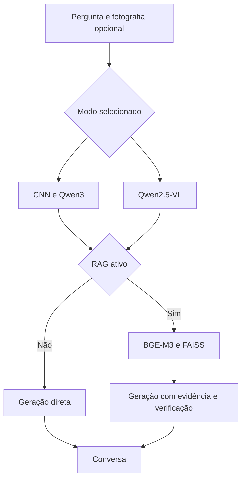

# Protocolo experimental · Tema F

**Aprendizagem Profunda Aplicada · TP2 · Grupo 2**

## 1. Problema e objetivo

Identificar hipóteses numa folha de videira e responder a perguntas de viticultura. A avaliação mede a qualidade da classificação, o suporte documental das afirmações e a capacidade de recusar pedidos sem evidência. F4 acompanha as perguntas, o baseline textual, a integração do LLM e do VLM e a avaliação de fidelidade.

## 2. Dados e corpus

- **Imagens.** FieldVitis v2, CC BY 4.0, com 158 saudáveis, 200 esca, 158 mancha-das-folhas e 39 podridão-negra. Divisão estratificada próxima de 70/15/15, com três seeds e pelo menos seis fotografias de podridão-negra no teste por seed. A unidade disponível é a imagem. Ficheiros com o mesmo SHA-256 ficam no mesmo split. Para comparar com a CNN, o manifesto tem de corresponder ao que foi usado no treino. [FieldVitis v2](https://doi.org/10.5281/zenodo.17307846)
- **Documentos.** `corpus.csv` conserva o título, a entidade, a data, o URL, a licença e o SHA-256. Indexam-se 16 documentos, incluindo os nove assinalados como condicionais. D10, D11 e D12 ficam reservados. D07 é o excerto de nove páginas fornecido. Os PDF e o índice ficam fora do Git.
- **Perguntas.** 20 de validação e 20 de teste. Cada conjunto tem 15 perguntas respondíveis pelo índice e cinco cuja resposta de referência está num documento reservado. Confirma por revisão humana a referência, a página e a ausência de evidência equivalente no índice para as perguntas de recusa.

## 3. Arquitetura e condições

Nos modos CNN, a fotografia é classificada antes de o Qwen3 receber a hipótese visual. Nos modos VLM, o Qwen2.5-VL faz a observação e gera a resposta. Em **VLM + RAG**, a descrição visual alimenta a geração documental pelo mesmo VLM. Sem fotografia, a resposta é textual. A decisão de usar visão e RAG segue o modo escolhido na interface.

Para a comparação principal de texto usam-se as mesmas perguntas e o mesmo Qwen3 nas três condições. `llm_cnn` gera sem pesquisa. `llm_rag_sem_limiar` recebe as passagens e exige citações válidas. `llm_cnn_rag` acrescenta o limiar e a verificação de suporte. Os dois modos VLM também podem ser avaliados nas mesmas perguntas. Para visão, compara-se a CNN treinada e o VLM zero-shot no mesmo split.

## 4. Perguntas e recusa

O modelo recebe o enunciado e, na avaliação de texto, cada pergunta começa com histórico vazio. A referência humana, a página esperada e a ação esperada ficam no registo da execução.

Na aplicação, uma etapa de âmbito filtra pedidos fora da viticultura e ajuda a resolver seguimentos. O RAG recupera as passagens por similaridade do cosseno. Se a evidência não chegar, a resposta é uma recusa. Para cada afirmação documental, o programa valida os identificadores e apresenta as citações com documento, página física do PDF e data. A verificação automática usa os excertos citados. A fidelidade é avaliada por pessoas.

A recusa reforçada também verifica se um edital, despacho ou circular explicitamente pedido pelo número existe no índice. Uma menção desse ato noutro documento não é evidência do seu conteúdo. A regra consulta os metadados do corpus.

## 5. Hipóteses

- **H1** · A fidelidade aumenta com RAG. Mede-se a diferença emparelhada por pergunta.
- **H2** · O modo com recusa reforçada recusa pelo menos 80% das perguntas sem suporte e recusa indevidamente até 10% das respondíveis.
- **H3** · A CNN treinada obtém Macro-F1 superior ao VLM zero-shot.
- **H4** · O RAG aumenta a consistência de ação e fontes nas repetições. Hipótese exploratória.

## 6. Métricas e anotação

| Medida | Cálculo |
|---|---|
| Fidelidade | Afirmações com suporte integral a dividir por todas as afirmações anotadas (`S`, `N`, `parcial`). |
| Correção da resposta | Proporção de respostas humanas marcadas corretas e completas face à referência. |
| Recall@5 | Presença do documento e da página física de referência entre as cinco passagens antes do limiar. A página é a aproximação à passagem de referência disponível no CSV. |
| Recusa | Taxa nas perguntas sem suporte e, em separado, nas respondíveis. |
| Consistência | Proporção de pares de repetições que coincidem na ação e no conjunto de fontes citadas. |
| Visão | Macro-F1, recall por classe, acurácia, cobertura e ECE com dez intervalos entre previsões aceites que têm confiança. Uma abstenção conta como falha para a classe real. |
| Latência | Tempo por item, incluindo as etapas locais chamadas nesse item. |

Dois anotadores fazem a revisão independente de cada resposta, um por folha, e resolvem as divergências numa folha de consenso. Quem escreveu uma pergunta fica fora da sua verificação de fidelidade. Mede-se a concordância com kappa de Cohen. O catálogo de alucinações regista afirmação, fonte real, tipo de erro, correção e efeito observado.

## 7. Repetições, seeds e registo

Texto com três repetições a temperatura 0 e três a 0,7 por condição e por pergunta. Seeds de geração 42, 43 e 44. Âmbito, observação visual e verificação de fontes correm a temperatura 0. Visão usa as três divisões do manifesto. O bootstrap usa 1 000 amostras com IC de 95%, por pergunta ou imagem, mantendo juntas as repetições da mesma unidade.

Cada item guarda estado, parâmetros, latência e, quando aplicável, passagens recuperadas, prompts e resposta. O manifesto regista versões dos dados e pesos por hash e o commit se o projeto estiver em Git. Uma falha de formato é registada separadamente. As métricas só abrangem os itens executados ou anotados indicados nas tabelas.

## 8. Validação e teste

Ajusta prompts, tamanho dos chunks, número de passagens, limiares e outras escolhas apenas na validação. Antes de correr o teste, fecha e versiona este protocolo e as configurações. Corre o teste uma vez por condição com os parâmetros fixados e preserva os JSON. O corpus de produção experimental continua a excluir os três documentos reservados.

## 9. Configuração

Qwen3 1.7B e Qwen2.5-VL 3B em Q4_K_M, BGE-M3 via Ollama, FAISS com vetores normalizados, `k=5`, chunks de até 1 150 carateres, sobreposição de 180 e limiar inicial de similaridade 0,43. Os YAML são a referência dos parâmetros de execução. Regista o ambiente, o dispositivo e os tempos da máquina usada na experiência.
