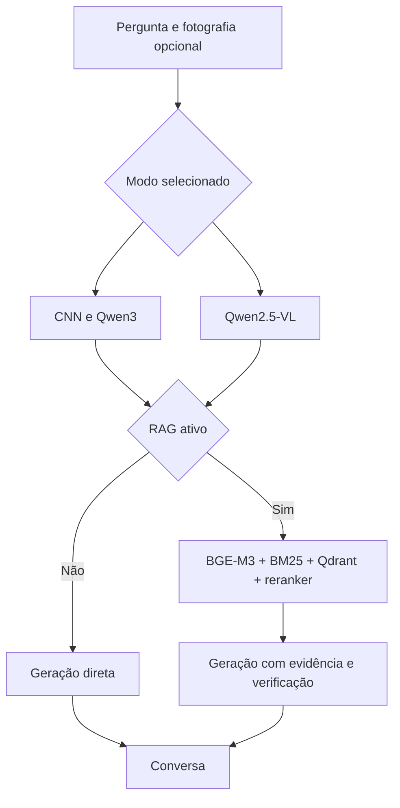

# Protocolo experimental · Tema F

**Aprendizagem Profunda Aplicada · TP2 · Grupo 2**

## 1. Problema e objetivo

Identificar hipóteses numa folha de videira e responder a perguntas de viticultura. A avaliação mede a qualidade da classificação, o suporte documental das afirmações e a capacidade de recusar pedidos sem evidência. F4 acompanha as perguntas, o baseline textual, a integração do LLM e do VLM e a avaliação de fidelidade.

## 2. Dados e corpus

- **Imagens.** FieldVitis v2, CC BY 4.0, com 158 saudáveis, 200 esca, 158 mancha-das-folhas e 39 podridão-negra. Divisão estratificada próxima de 70/15/15, com três seeds e pelo menos seis fotografias de podridão-negra no teste por seed. A unidade disponível é a imagem. Ficheiros com o mesmo SHA-256 ficam no mesmo split. Para comparar com a CNN, o manifesto tem de corresponder ao que foi usado no treino. [FieldVitis v2](https://doi.org/10.5281/zenodo.17307846)
- **Documentos.** `corpus.csv` conserva o título, a entidade, a data, o URL, a licença e o SHA-256. Indexam-se 16 documentos, incluindo os nove assinalados como condicionais. D10, D11 e D12 ficam reservados. D07 é o excerto de nove páginas fornecido. Os PDF e o índice ficam fora do Git.
- **Perguntas.** 20 de validação e 20 de teste. Cada conjunto tem 15 perguntas respondíveis pelo índice e cinco cuja resposta de referência está num documento reservado. Confirma por revisão humana a referência, a página e a ausência de evidência equivalente no índice para as perguntas de recusa.

## 3. Arquitetura e condições

Nos modos CNN, a fotografia é classificada antes de o Qwen3 receber a hipótese visual. Nos modos VLM, o Qwen2.5-VL faz a observação e gera a resposta. Em **VLM + RAG**, a descrição visual alimenta a geração documental pelo mesmo VLM. Sem fotografia, a resposta é textual. A decisão de usar visão e RAG segue o modo escolhido na interface.

A comparação principal do F4 usa as mesmas perguntas, sem fotografias, com histórico vazio em cada corrida e o mesmo Qwen3 nas condições `llm_cnn` (baseline sem RAG; a CNN não intervém) e `llm_cnn_rag` (RAG, corte e verificação). `llm_rag_sem_limiar` é uma ablação opcional: recupera e exige citações válidas, mas não aplica o corte nem a verificação de suporte. Os dois modos VLM também podem ser avaliados nas mesmas perguntas de texto.

O comando `avaliar imagem` compara **classificação** CNN/VLM no mesmo split, não qualidade de respostas. O comando `avaliar respostas-imagem` compara VLM/VLM + RAG com a mesma pergunta, fotografia e hash, sem histórico. Em VLM, a fotografia é enviada à observação e à geração final. Em VLM + RAG, é enviada à observação; a geração final recebe a hipótese/estado visual e as passagens. A descrição contribui para a consulta quando a pergunta usa a imagem. Os bytes da fotografia não chegam à geração documental final. Esta diferença é parte das condições, preservada da versão do Rui; não atribuir todos os efeitos observados apenas à presença de documentos.

## 4. Perguntas e recusa

O modelo recebe o enunciado e, na avaliação de texto, cada pergunta começa com histórico vazio. A referência, a página e a ação esperada nunca são usadas para formular o prompt nem para escolher a consulta. A aplicação mantém o histórico ao mudar de modo; para ensaios manuais é obrigatório começar uma conversa nova por condição e voltar a selecionar o modo (Nova conversa repõe LLM + CNN + RAG). Uma resposta com RAG no histórico pode informar uma condição sem RAG. A referência humana, a página esperada e a ação esperada ficam no registo da execução.

Na aplicação, uma etapa de âmbito filtra pedidos fora da viticultura e ajuda a resolver seguimentos. O RAG recupera até 30 candidatos por BGE-M3 normalizado e BM25 em português, funde por RRF no Qdrant e reordena por cross-encoder BGE-reranker-v2-m3 (máximo de 512 tokens por par). Conserva cinco passagens antes do corte para o Recall@5; a condição reforçada só fornece à geração as que atingem 0,60 no reranker. O corte é aplicado uma vez. Não é o antigo limiar de cosseno 0,43 do FAISS. Os filtros por `doc_id` e `estado_fonte` excluem os documentos reservados em ambas as pesquisas. A avaliação inspeciona a coleção e recusa payloads inválidos e presença de documentos reservados. Se a evidência não chegar, a resposta é uma recusa. Para cada afirmação documental, o programa valida os identificadores e apresenta as citações com documento, página física do PDF e data. A verificação automática usa os excertos citados. A fidelidade é avaliada por pessoas.

A recusa reforçada também verifica se um edital, despacho ou circular explicitamente pedido pelo número existe no índice. Uma menção desse ato noutro documento não é evidência do seu conteúdo. A regra consulta os metadados do corpus.

## 5. Hipóteses

- **H1** · A fidelidade aumenta com RAG. Mede-se a diferença emparelhada por pergunta.
- **H2** · O modo com recusa reforçada recusa pelo menos 80% das perguntas sem suporte e recusa indevidamente até 10% das respondíveis.
- **H3** · A CNN treinada obtém Macro-F1 superior ao VLM zero-shot.
- **H4** · O RAG aumenta a consistência de ação e fontes nas repetições. Hipótese exploratória.

## 6. Métricas e anotação

| Medida | Cálculo |
|---|---|
| Fidelidade | Afirmações com suporte integral a dividir por todas as afirmações anotadas (`S`, `N`, `parcial`). |
| Correção da resposta | Proporção de respostas humanas marcadas corretas e completas face à referência. |
| Recall@5 | Presença do documento e da página física de referência entre as cinco passagens antes do limiar. A página é a aproximação à passagem de referência disponível no CSV. |
| Recusa | Taxa nas perguntas sem suporte e, em separado, nas respondíveis. |
| Consistência | Proporção de pares de repetições que coincidem na ação e no conjunto de fontes citadas. |
| Visão | Macro-F1, recall por classe, acurácia, cobertura e ECE com dez intervalos entre previsões aceites que têm confiança. Uma abstenção conta como falha para a classe real. |
| Latência | Tempo por item, incluindo as etapas locais chamadas nesse item. |

Dois anotadores fazem a revisão independente de cada resposta, um por folha, e resolvem as divergências numa folha de consenso. Quem escreveu uma pergunta fica fora da sua verificação de fidelidade. Mede-se a concordância com kappa de Cohen. O catálogo de alucinações regista afirmação, fonte real, tipo de erro, correção e efeito observado.

## 7. Repetições, seeds e registo

Texto com três repetições a temperatura 0 e três a 0,7 por condição e por pergunta. Seeds de geração 42, 43 e 44. Âmbito, observação visual e verificação de fontes correm a temperatura 0. Visão usa as três divisões do manifesto. O bootstrap usa 1 000 amostras com IC de 95%, por pergunta ou imagem, mantendo juntas as repetições da mesma unidade.

Cada item guarda estado, parâmetros, latência e, quando aplicável, passagens recuperadas antes do corte, prompts e resposta. O manifesto inclui nome/contagem/documentos/hash dos payloads da coleção, incluindo documentos em falta. O hash dos payloads não certifica os vetores nem impede alterações concorrentes; o grupo deve congelar a coleção durante os ensaios. As revisões de pesos do Hugging Face da coleção original precisam de confirmação do autor; conservam-se os identificadores do colega. O manifesto regista versões dos dados e pesos por hash e o commit se o projeto estiver em Git. Uma falha de formato é registada separadamente. As métricas só abrangem os itens executados ou anotados indicados nas tabelas.

## 8. Validação e teste

Ajusta prompts, tamanho dos chunks, número de passagens, limiares e outras escolhas apenas na validação. Antes de correr o teste, fecha e versiona este protocolo e as configurações. Corre o teste uma vez por condição com os parâmetros fixados e preserva os JSON. O corpus de produção experimental continua a excluir os três documentos reservados.

## 9. Configuração

| Parâmetro | Condição efetiva |
|---|---|
| LLM / VLM | `qwen3:1.7b-q4_K_M` / `qwen2.5vl:3b-q4_K_M`, Ollama local, LangChain |
| Embeddings | `BAAI/bge-m3`, SentenceTransformers, normalizados, 1024 dimensões |
| Pesquisa | Qdrant, `vetor_denso` Cosine + `bm25` com IDF, BM25 português, RRF, 30 candidatos |
| Reordenação | `BAAI/bge-reranker-v2-m3`, pares até 512 tokens, cinco resultados |
| Corte reforçado | Score do reranker >= 0,60; sem corte na ablação |
| Ingestão nova | Markdown por página, cabeçalhos, chunks 1200, sobreposição 200, mínimo 50 carateres; OCR registado |
| Contexto de geração | 8192 tokens; até seis turnos na aplicação, zero nos ensaios |
| Limite de geração | Sem RAG: 1000 tokens; com RAG: `min(420, max_resposta_tokens)` |
| Formato de geração | Sem RAG: JSON `resposta`; RAG: JSON `primeira`, `segunda`, `resposta`, 1–3 frases |
| Etapas auxiliares | Âmbito 290 tokens; análise visual 360; verificação documental 75; revisão de reparação livre 60; temperatura 0 |

O prompt geral de `base.yaml` é partilhado e foi preservado. As instruções específicas das condições são distintas: geração livre sem fontes ou geração documental com seleção de passagens. A condição reforçada verifica números, referências a atos e suporte pelo próprio modelo, podendo reformular uma vez ou recusar. A ablação continua a exigir identificadores de citações válidos. Estas diferenças de limite/formato/verificação já existiam na base do Rui e afetam a interpretação da comparação; o efeito observado não é apenas a adição de contexto.

A coleção real lida em 16/11/2026 tinha 989 passagens de 14 documentos; D07 e D14 estavam em falta face aos 16 selecionados no CSV. D10–D12 não estavam presentes. Não foi alterada. Antes dos ensaios oficiais, o grupo deve decidir e registar se congela essa coleção de 14 documentos ou constrói uma nova de 16. Não misturar resultados das duas coleções. Uma reconstrução com a versão de extração fixada nesta entrega pode produzir passagens diferentes das originais.

Os YAML são a referência dos parâmetros. Regista o ambiente, dispositivo, versões, revisões dos modelos, documentos e tempos da máquina da experiência. A CNN final e o pré-processamento/ordem de classes precisam de confirmação do responsável; o adaptador existente foi preservado.

## 10. Trabalho humano pendente

1. Validar as 40 referências, páginas e ações; verificar se os documentos indexados contêm evidência equivalente para perguntas de recusa.
2. Confirmar com o colega a proveniência da coleção e decidir os documentos/extração definitivos apenas na validação.
3. Confirmar pesos, classes, pré-processamento e splits da CNN treinada; correr a classificação no FieldVitis real.
4. Executar as condições fixadas, preencher as duas folhas de anotação e resolver divergências por consenso. Não confundir testes de funcionamento com resultados do projeto.
5. Comparar os pares de respostas VLM/VLM + RAG quanto a adequação à fotografia/pergunta, correção, prudência do diagnóstico, suporte e páginas das citações. Os JSON de `respostas-imagem` destinam-se a revisão humana separada e não às métricas de classificação.

As verificações efetivamente realizadas e os comandos repetíveis estão em `INTEGRACAO.md`.
