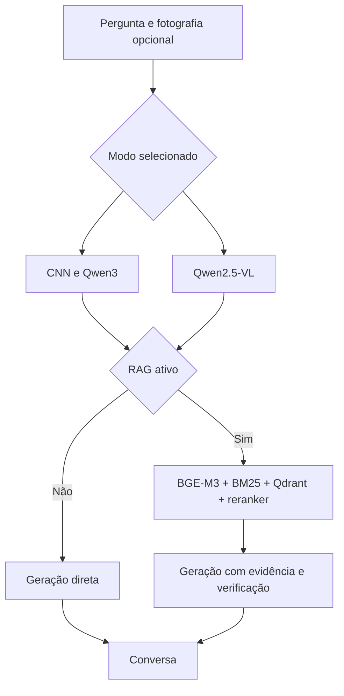

# Protocolo experimental · Tema F

**Aprendizagem Profunda Aplicada · TP2 · Grupo 2**

## 1. Problema e objetivo

Identificar hipóteses numa folha de videira e responder a perguntas de viticultura. A avaliação mede a qualidade da classificação, o suporte documental das afirmações e a capacidade de recusar pedidos sem evidência. O protocolo abrange as perguntas de referência, a comparação das condições textuais e visuais e a avaliação humana das respostas.

## 2. Dados e corpus

- **Imagens.** FieldVitis v2, CC BY 4.0, com 158 saudáveis, 200 esca, 158 mancha-das-folhas e 39 podridão-negra, acrescido de 160 imagens `Outro`, com fontes em `data/originais/cnn/outro_fontes.csv`. A seed 1 tem 454 imagens de treino, 98 de validação, 99 de teste e 64 de holdout, com seed de reserva 2026. As 555 imagens originais mantêm as suas divisões: 352/76/77 e 50 reservadas. Só estão disponíveis pesos da ResNet50 seed 1. O manifesto ativo `data/splits.json` adapta as divisões recebidas sem novo sorteio; os originais das seeds 0/1/2 estão em `data/originais/`. A unidade disponível é a imagem. A preparação verifica duplicados exatos e sobreposições; estas verificações não demonstram separação por videira/local nem ausência de quase duplicados. [FieldVitis v2](https://doi.org/10.5281/zenodo.17307846)
- **Documentos.** `data/corpus.csv` conserva o título, a entidade, a data, o URL, a licença e o SHA-256. Indexam-se 14 documentos, incluindo sete condicionais. D07 e D14 ficam excluídos da indexação; D10, D11 e D12 ficam reservados para avaliar a recusa. D14 fornece também as referências das seis perguntas de recusa de sintomas e tratamento. Os PDF e o índice ficam fora do Git.
- **Perguntas.** 20 de validação e 20 de teste, com 15 respondíveis e cinco de recusa em cada conjunto. As referências, páginas e ações esperadas exigem revisão humana, incluindo a confirmação de que não existe evidência equivalente no índice para as perguntas de recusa.

## 3. Arquitetura e condições

| Condição | Gerador | Análise da fotografia, quando existe | Recuperação |
|---|---|---|---|
| `llm_cnn` | Qwen3 | CNN | Não |
| `llm_rag_sem_limiar` | Qwen3 | CNN | RAG sem corte nem verificação reforçada |
| `llm_cnn_rag` | Qwen3 | CNN | RAG com corte e verificação reforçada |
| `vlm` | Qwen2.5-VL | VLM | Não |
| `vlm_rag` | Qwen2.5-VL | VLM | RAG com corte e verificação reforçada |

Sem fotografia, as cinco condições aceitam texto e a CNN não intervém. A condição `llm_rag_sem_limiar` é experimental e não aparece na interface. Pode recusar quando não recupera passagens ou a geração falha.

A comparação textual principal utiliza as três condições LLM com as mesmas perguntas, sem fotografia e com histórico vazio por item. Os dois modos VLM também podem ser avaliados nas mesmas perguntas. `avaliar imagem` compara classificação CNN/VLM no mesmo split. `avaliar respostas-imagem` compara, por predefinição, as respostas dos quatro modos à mesma pergunta e fotografia, com o mesmo hash e sem histórico; `--condicoes` permite selecionar um subconjunto.

Todos os modos partilham um único prompt de sistema em português de Portugal, com registo formal e impessoal, e o esquema e limite de resposta da secção 9. O sistema permite conhecimento próprio quando não existem passagens e exige evidência documental quando são fornecidas.

Nos pares com e sem RAG, o LLM recebe a mesma hipótese e probabilidades da CNN, sem fotografia nem sinais observados, pelo que apresenta eventuais sintomas como sinais gerais a confirmar; o VLM recebe a fotografia na observação inicial e na geração final, com a mesma hipótese, estado e descrição visual. As regras de prudência dependem destes dados. As diferenças dentro de cada par ficam na recuperação, citações e recusa.

Reparações e revisões preservam o sistema comum, com instruções adicionais em mensagens de contexto. As etapas auxiliares de âmbito e observação visual mantêm parâmetros próprios. A comparação CNN/LLM com VLM envolve modelos e representações visuais diferentes.

## 4. Perguntas e recusa

O modelo recebe o enunciado. A referência, a página e a ação esperada nunca são usadas para formular o prompt nem para escolher a consulta. A aplicação mantém o histórico ao mudar de modo; para ensaios manuais é obrigatório começar uma conversa nova por condição e voltar a selecionar o modo (Nova conversa repõe LLM + CNN + RAG). Uma resposta com RAG no histórico pode informar uma condição sem RAG. As referências ficam apenas no registo da avaliação.

Na aplicação, uma etapa de âmbito filtra pedidos fora da viticultura e ajuda a resolver seguimentos. O RAG recupera até 30 candidatos por BGE-M3 normalizado e BM25 em português, funde por RRF no Qdrant e reordena por cross-encoder BGE-reranker-v2-m3 (máximo de 512 tokens por par). Conserva cinco passagens antes do corte para o Recall@5; a condição reforçada só fornece à geração as que atingem 0,60 no reranker. O corte é aplicado uma vez. Os filtros por `doc_id` e `estado_fonte` excluem os documentos reservados em ambas as pesquisas. A avaliação inspeciona a coleção e recusa payloads inválidos e presença de documentos reservados. Se a evidência não chegar, a resposta é uma recusa. Para cada afirmação documental, o programa valida os identificadores e apresenta as citações com documento, página física do PDF e data. A verificação automática usa os excertos citados. A fidelidade é avaliada por pessoas.

A recusa reforçada também verifica se um edital, despacho ou circular explicitamente pedido pelo número consta dos títulos dos documentos selecionados no corpus para indexação. Uma menção desse ato noutro documento não é evidência do seu conteúdo. A regra consulta os metadados do corpus.

O registo identifica `verificar_documento`, a origem nos metadados e se a pesquisa foi omitida. As taxas de recusa são também discriminadas pelo motivo e pelo tipo de pergunta, mantendo o denominador de todas as perguntas relevantes. A auditoria estática (`src.avaliar dados`) mostra que esta regra abrange quatro das dez perguntas de recusa, as quatro de regulamentação. As restantes distribuem-se por três de sintomas e três de tratamento, com referências em D14. Não confundir essa cobertura com recusas observadas nem com deteção geral de falta de suporte. Novas perguntas de recusa exigem validação humana antes de integrar a avaliação.

## 5. Hipóteses

- **H1** · A fidelidade aumenta com RAG. Mede-se a diferença emparelhada por pergunta.
- **H2** · O modo com recusa reforçada recusa pelo menos 80% das perguntas sem suporte e recusa indevidamente até 10% das respondíveis.
- **H3** · A CNN treinada obtém Macro-F1 superior ao VLM zero-shot.
- **H4** · O RAG aumenta a consistência entre repetições. Publicam-se separadamente acordo de ação/fontes e, quando houver anotação humana, de classe e de classe/ação/fontes. Hipótese exploratória.

## 6. Métricas e anotação

| Medida | Cálculo |
|---|---|
| Fidelidade | Afirmações com suporte integral a dividir por todas as afirmações anotadas (`S`, `N`, `parcial`). |
| Correção da resposta | Proporção de respostas humanas marcadas corretas e completas face à referência. |
| Recall de página@5 | Presença do documento e da página física de referência entre as cinco passagens antes do limiar. É uma aproximação; não mede o acerto na passagem exata. |
| Recusa | Taxa nas perguntas sem suporte e, em separado, nas respondíveis. |
| Consistência | Acordo de ação/fontes; acordo da classe expressa na resposta anotada em `classe_resposta`; e acordo conjunto. Classe não anotada, `sem_classe` e `indeterminada` não geram acordo de identificação. Publica-se a cobertura de anotação; a classe visual não substitui a classe da resposta. |
| Visão | Macro-F1, recall por classe, acurácia, cobertura e ECE com dez intervalos entre previsões aceites que têm confiança. Uma abstenção conta como falha para a classe real. |
| Latência | Tempo por item, incluindo as etapas locais chamadas nesse item. |

Dois anotadores fazem a revisão independente de cada resposta, um por folha, e resolvem as divergências numa folha de consenso. Quem escreveu uma pergunta fica fora da sua verificação de fidelidade. Mede-se a concordância com kappa de Cohen. O catálogo de alucinações regista afirmação, fonte real, tipo de erro, correção e efeito observado.

## 7. Repetições, seeds e registo

Texto com três repetições a temperatura 0 e três a 0,7 por condição e por pergunta. Seeds de geração 42, 43 e 44. Âmbito, observação visual e verificação de fontes correm a temperatura 0. Visão usa apenas a divisão correspondente ao treino da CNN seed 1. A seed de geração VLM é 42, distinta da seed de treino e da seed de amostragem do holdout (2026). Os pesos das seeds 0 e 2 continuam em falta; não se reproduzem três modelos com um checkpoint. O bootstrap usa 1 000 amostras com IC de 95%, por pergunta ou imagem, mantendo juntas as repetições da mesma unidade.

Cada item guarda estado, parâmetros, latência e, quando aplicável, passagens recuperadas antes do corte, prompts e resposta. O manifesto inclui nome/contagem/documentos/hash dos payloads da coleção, incluindo documentos em falta. O hash dos payloads não certifica os vetores nem impede alterações concorrentes; a coleção deve ser congelada durante os ensaios. As revisões de pesos do Hugging Face da coleção original precisam de confirmação nos registos de construção; conservam-se os identificadores da implementação original. O manifesto regista versões dos dados e pesos por hash e o commit se o projeto estiver em Git. Uma falha de formato é registada separadamente. As métricas só abrangem os itens executados ou anotados indicados nas tabelas.

## 8. Validação e teste

Ajustar prompts, tamanho dos chunks, número de passagens, limiares e outras escolhas apenas na validação. Antes de executar o teste, fechar e versionar este protocolo e as configurações. Executar o teste uma vez por condição com os parâmetros fixados e preservar os JSON. O corpus de produção experimental continua a excluir os documentos que fornecem as referências de recusa: D10, D11, D12 e D14.

`src.preparar_cnn` adapta as partições originais e `src.avaliar imagem` verifica a sua correspondência e o hash do checkpoint. A comparação CNN/VLM mantém as quatro classes de folhas: `--split teste` seleciona 77 imagens e `--split holdout` 50. `Outro` é excluído desta comparação; a avaliação específica da rejeição fica pendente das imagens adicionais. `--limite` é exclusivo da validação.

O teste interno já foi observado durante o desenvolvimento da CNN. Contém seis casos de black rot; o holdout contém quatro, abaixo dos seis previstos no D1. O holdout mantém-se separado da afinação, sem novas divisões para alterar esta composição. A verificação de integridade dos ficheiros não constitui inferência nem avaliação de desempenho.

## 9. Configuração

| Parâmetro | Condição efetiva |
|---|---|
| LLM / VLM | `qwen3:1.7b-q4_K_M` / `qwen2.5vl:3b-q4_K_M`, Ollama local, LangChain |
| Embeddings | `BAAI/bge-m3`, SentenceTransformers, normalizados, 1024 dimensões |
| Pesquisa | Qdrant, `vetor_denso` Cosine + `bm25` com IDF, BM25 português, RRF, 30 candidatos |
| Reordenação | `BAAI/bge-reranker-v2-m3`, pares até 512 tokens, cinco resultados |
| Corte reforçado | Score do reranker >= 0,60; sem corte na ablação |
| Ingestão nova | Markdown por página, cabeçalhos, chunks 1200, sobreposição 200, mínimo 50 carateres; OCR registado |
| Contexto de geração | 8192 tokens; até seis turnos na aplicação, zero nos ensaios |
| Limite de geração | `max_resposta_tokens` (atualmente 1000) em todos os modos, com ou sem fotografia, incluindo reparações e revisões da resposta |
| Formato de geração | JSON comum `primeira`, `segunda`, `resposta`, com parágrafos curtos, em todos os modos; sem RAG, os campos de seleção de passagens são 0 |
| Etapas auxiliares | Âmbito 290 tokens; análise visual 360; verificação documental 75; revisão de reparação livre 60; temperatura 0 |

Os YAML são a referência dos parâmetros. Registar o ambiente, dispositivo, versões, revisões dos modelos, documentos e tempos da máquina da experiência. A CNN é ResNet50, seed 1, modelo completo `.keras`, entrada NHWC float32 `(1,224,224,3)`, EXIF/RGB/redimensionamento bilinear com padding preto e `preprocess_input` ResNet50 (BGR e médias ImageNet, sem dividir por 255). A saída já é softmax; Black_rot, Esca, Healthy, Leaf_blight, Outro são mapeados para black_rot, esca, saudavel, leaf_blight, outro, nesta ordem. Leaf_blight mantém o nome mancha-das-folhas, sem o equiparar a míldio. A regra fornecida rejeita `Outro` ou confiança máxima inferior a 0,58, antes da recuperação e geração da resposta. Quando aceita, a hipótese e as cinco probabilidades chegam ao LLM; `ok` não confirma um diagnóstico. A classe acrescenta contexto à consulta RAG; sem nova fotografia, não se reinjeta a CNN anterior. O VLM mantém as suas quatro classes de folhas e o percurso próprio de rejeição.

## 10. Trabalho humano pendente

1. Validar as 40 referências, páginas e ações, incluindo a ausência de evidência equivalente para perguntas de recusa.
2. Confirmar a proveniência dos modelos e a composição da coleção documental.
3. Obter os pesos das seeds CNN 0 e 2 caso se pretendam reproduzir três treinos.
4. Executar as condições fixadas, preencher as duas folhas de anotação independentes e resolver divergências por consenso.
5. Avaliar as respostas dos quatro modos quanto à adequação à fotografia e pergunta, correção, prudência, suporte e páginas citadas.

Os comandos e destinos estão no [README](README.md). Os registos históricos das integrações estão em [INTEGRACAO_RAG.md](INTEGRACAO_RAG.md) e [INTEGRACAO_CNN.md](INTEGRACAO_CNN.md).
