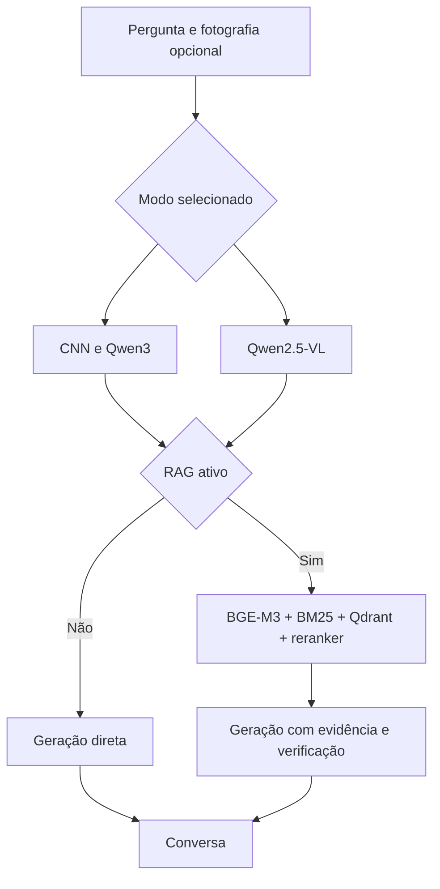

# Protocolo experimental · Tema F

**Aprendizagem Profunda Aplicada · TP2 · Grupo 2**

## 1. Problema e objetivo

Identificar hipóteses numa folha de videira e responder a perguntas de viticultura. A avaliação mede a qualidade da classificação, o suporte documental das afirmações e a capacidade de recusar pedidos sem evidência. O protocolo abrange as perguntas de referência, a comparação das condições textuais e visuais e a avaliação humana das respostas.

## 2. Dados e corpus

- **Imagens.** FieldVitis v2, CC BY 4.0, com 158 saudáveis, 200 esca, 158 mancha-das-folhas e 39 podridão-negra. A preparação original da CNN reservou 50 imagens (seed de amostragem 2026) e dividiu as restantes 505 nas seeds de treino 0/1/2: 352 treino, 76 validação e 77 teste interno, com pelo menos seis fotografias de podridão-negra no teste interno. Só foram entregues pesos da ResNet50 seed 1. O manifesto ativo adapta essa divisão, sem novo sorteio; os originais ficam em `data/originais/`. A unidade disponível é a imagem. Na auditoria desta entrega não houve duplicados exatos de ficheiros ou píxeis nem sobreposições entre treino, validação, teste e holdout, nas três seeds. Não se demonstrou separação por videira/local ou ausência de quase duplicados. O antigo teste da seed 42 continha 53/84 imagens usadas no treino recebido e não serve como teste independente. [FieldVitis v2](https://doi.org/10.5281/zenodo.17307846)
- **Documentos.** `corpus.csv` conserva o título, a entidade, a data, o URL, a licença e o SHA-256. Indexam-se 14 documentos, incluindo os sete assinalados como condicionais. D07 e D14 ficam excluídos da indexação; D10, D11 e D12 ficam reservados para a avaliação da recusa. Os PDF e o índice ficam fora do Git.
- **Perguntas.** 20 de validação e 20 de teste. Cada conjunto tem 15 perguntas respondíveis pelo índice e cinco cuja resposta de referência está num documento reservado. Na validação, Q023 passa a perguntar pelas consequências da desfolha precoce descritas em D15, página 1, mantendo o tipo `impacto` e a doença `mancha_das_folhas`. A nova referência permanece pendente de validação humana independente. Confirmar por revisão humana a referência, a página e a ausência de evidência equivalente no índice para as perguntas de recusa.

## 3. Arquitetura e condições

Nos modos CNN, a fotografia é classificada antes de o Qwen3 receber a hipótese visual. Nos modos VLM, o Qwen2.5-VL faz a observação e gera a resposta. Em **VLM + RAG**, a descrição visual alimenta a geração documental pelo mesmo VLM. Sem fotografia, a resposta é textual. A decisão de usar visão e RAG segue o modo escolhido na interface.

A comparação textual principal utiliza as mesmas perguntas, sem fotografias, com histórico vazio em cada corrida e o mesmo Qwen3 em três condições: `llm_cnn` (baseline sem RAG; a CNN não intervém), `llm_rag_sem_limiar` (RAG com citações válidas, sem corte nem verificação de suporte) e `llm_cnn_rag` (RAG, corte e verificação). Estas três condições são agora a predefinição do avaliador, conforme a comparação sem RAG/RAG/RAG+recusa do D1. Os dois modos VLM também podem ser avaliados nas mesmas perguntas de texto. A condição intermédia ainda pode recusar se não recuperar passagens ou se a geração falhar; não significa ausência absoluta de recusa.

O comando `avaliar imagem` compara **classificação** CNN/VLM no mesmo split, não qualidade de respostas. O comando `avaliar respostas-imagem` compara por predefinição os quatro modos com a mesma pergunta, fotografia e hash, sem histórico; `--condicoes` permite selecionar um subconjunto. Nos modos LLM, o gerador recebe apenas a mesma hipótese e probabilidades da CNN com e sem RAG, sem fotografia nem sinais observados: deve apresentar eventuais sintomas como sinais gerais a confirmar. Nos dois modos VLM, a mesma fotografia é enviada à observação inicial e à geração final, com a mesma hipótese, estado e descrição visual. Quando há RAG, acrescentam-se as passagens documentais; a descrição também contribui para a consulta quando a pergunta usa a imagem. O prompt de sistema, o esquema e o limite de resposta são comuns. A classificação CNN e a observação inicial VLM não são alteradas. A comparação entre CNN/LLM e VLM continua a envolver modelos e representações visuais diferentes.

## 4. Perguntas e recusa

O modelo recebe o enunciado e, na avaliação de texto, cada pergunta começa com histórico vazio. A referência, a página e a ação esperada nunca são usadas para formular o prompt nem para escolher a consulta. A aplicação mantém o histórico ao mudar de modo; para ensaios manuais é obrigatório começar uma conversa nova por condição e voltar a selecionar o modo (Nova conversa repõe LLM + CNN + RAG). Uma resposta com RAG no histórico pode informar uma condição sem RAG. A referência humana, a página esperada e a ação esperada ficam no registo da execução.

Na aplicação, uma etapa de âmbito filtra pedidos fora da viticultura e ajuda a resolver seguimentos. O RAG recupera até 30 candidatos por BGE-M3 normalizado e BM25 em português, funde por RRF no Qdrant e reordena por cross-encoder BGE-reranker-v2-m3 (máximo de 512 tokens por par). Conserva cinco passagens antes do corte para o Recall@5; a condição reforçada só fornece à geração as que atingem 0,60 no reranker. O corte é aplicado uma vez. Não é o antigo limiar de cosseno 0,43 do FAISS. Os filtros por `doc_id` e `estado_fonte` excluem os documentos reservados em ambas as pesquisas. A avaliação inspeciona a coleção e recusa payloads inválidos e presença de documentos reservados. Se a evidência não chegar, a resposta é uma recusa. Para cada afirmação documental, o programa valida os identificadores e apresenta as citações com documento, página física do PDF e data. A verificação automática usa os excertos citados. A fidelidade é avaliada por pessoas.

A recusa reforçada também verifica se um edital, despacho ou circular explicitamente pedido pelo número existe no índice. Uma menção desse ato noutro documento não é evidência do seu conteúdo. A regra consulta os metadados do corpus.

O registo identifica `verificar_documento`, a origem nos metadados e se a pesquisa foi omitida. As taxas de recusa são também discriminadas pelo motivo, mantendo o denominador de todas as perguntas relevantes. A auditoria estática (`src.avaliar dados`) mostra que esta regra abrange nove das dez perguntas de recusa, todas de regulamentação. Não confundir essa cobertura com recusas observadas nem com deteção geral de falta de suporte. Novas perguntas de recusa exigem validação humana antes de integrar a avaliação.

## 5. Hipóteses

- **H1** · A fidelidade aumenta com RAG. Mede-se a diferença emparelhada por pergunta.
- **H2** · O modo com recusa reforçada recusa pelo menos 80% das perguntas sem suporte e recusa indevidamente até 10% das respondíveis.
- **H3** · A CNN treinada obtém Macro-F1 superior ao VLM zero-shot.
- **H4** · O RAG aumenta a consistência entre repetições. Publicam-se separadamente acordo de ação/fontes e, quando houver anotação humana, de classe e de classe/ação/fontes. Hipótese exploratória.

## 6. Métricas e anotação

| Medida | Cálculo |
|---|---|
| Fidelidade | Afirmações com suporte integral a dividir por todas as afirmações anotadas (`S`, `N`, `parcial`). |
| Correção da resposta | Proporção de respostas humanas marcadas corretas e completas face à referência. |
| Recall de página@5 | Presença do documento e da página física de referência entre as cinco passagens antes do limiar. É uma aproximação; não mede o acerto na passagem exata. |
| Recusa | Taxa nas perguntas sem suporte e, em separado, nas respondíveis. |
| Consistência | Acordo de ação/fontes; acordo da classe expressa na resposta anotada em `classe_resposta`; e acordo conjunto. Classe não anotada, `sem_classe` e `indeterminada` não geram acordo de identificação. Publica-se a cobertura de anotação; a classe visual não substitui a classe da resposta. |
| Visão | Macro-F1, recall por classe, acurácia, cobertura e ECE com dez intervalos entre previsões aceites que têm confiança. Uma abstenção conta como falha para a classe real. |
| Latência | Tempo por item, incluindo as etapas locais chamadas nesse item. |

Dois anotadores fazem a revisão independente de cada resposta, um por folha, e resolvem as divergências numa folha de consenso. Quem escreveu uma pergunta fica fora da sua verificação de fidelidade. Mede-se a concordância com kappa de Cohen. O catálogo de alucinações regista afirmação, fonte real, tipo de erro, correção e efeito observado.

## 7. Repetições, seeds e registo

Texto com três repetições a temperatura 0 e três a 0,7 por condição e por pergunta. Seeds de geração 42, 43 e 44. Âmbito, observação visual e verificação de fontes correm a temperatura 0. Visão usa apenas a divisão correspondente ao treino da CNN seed 1. A seed de geração VLM é 42, distinta da seed de treino e da seed de amostragem do holdout (2026). Os pesos das seeds 0 e 2 continuam em falta; não se reproduzem três modelos com um checkpoint. O bootstrap usa 1 000 amostras com IC de 95%, por pergunta ou imagem, mantendo juntas as repetições da mesma unidade.

Cada item guarda estado, parâmetros, latência e, quando aplicável, passagens recuperadas antes do corte, prompts e resposta. O manifesto inclui nome/contagem/documentos/hash dos payloads da coleção, incluindo documentos em falta. O hash dos payloads não certifica os vetores nem impede alterações concorrentes; o grupo deve congelar a coleção durante os ensaios. As revisões de pesos do Hugging Face da coleção original precisam de confirmação do autor; conservam-se os identificadores da implementação original. O manifesto regista versões dos dados e pesos por hash e o commit se o projeto estiver em Git. Uma falha de formato é registada separadamente. As métricas só abrangem os itens executados ou anotados indicados nas tabelas.

## 8. Validação e teste

Ajustar prompts, tamanho dos chunks, número de passagens, limiares e outras escolhas apenas na validação. Antes de executar o teste, fechar e versionar este protocolo e as configurações. Executar o teste uma vez por condição com os parâmetros fixados e preservar os JSON. O corpus de produção experimental continua a excluir os três documentos reservados.

## 9. Configuração

| Parâmetro | Condição efetiva |
|---|---|
| LLM / VLM | `qwen3:1.7b-q4_K_M` / `qwen2.5vl:3b-q4_K_M`, Ollama local, LangChain |
| Embeddings | `BAAI/bge-m3`, SentenceTransformers, normalizados, 1024 dimensões |
| Pesquisa | Qdrant, `vetor_denso` Cosine + `bm25` com IDF, BM25 português, RRF, 30 candidatos |
| Reordenação | `BAAI/bge-reranker-v2-m3`, pares até 512 tokens, cinco resultados |
| Corte reforçado | Score do reranker >= 0,60; sem corte na ablação |
| Ingestão nova | Markdown por página, cabeçalhos, chunks 1200, sobreposição 200, mínimo 50 carateres; OCR registado |
| Contexto de geração | 8192 tokens; até seis turnos na aplicação, zero nos ensaios |
| Limite de geração | `max_resposta_tokens` (atualmente 1000) em todos os modos, com ou sem fotografia, incluindo reparações e revisões da resposta |
| Formato de geração | JSON comum `primeira`, `segunda`, `resposta`, com parágrafos curtos, em todos os modos; sem RAG, os campos de seleção de passagens são 0 |
| Etapas auxiliares | Âmbito 290 tokens; análise visual 360; verificação documental 75; revisão de reparação livre 60; temperatura 0 |

O prompt geral de `base.yaml` e as instruções de geração formam um único prompt de sistema, idêntico em todos os modos, com ou sem fotografia, em português de Portugal e com registo formal e impessoal. O esquema de resposta, as instruções gerais e o orçamento de geração também são comuns. O prompt prevê o uso de conhecimento próprio quando não são fornecidas passagens e o uso exclusivo da evidência documental quando existem passagens. As regras de prudência visual são condicionais aos dados fornecidos, sem alterar o sistema entre condições. Nos pares com e sem RAG, mantêm-se o modelo e a informação visual; as diferenças ficam na recuperação, nas citações e na recusa. A condição reforçada mantém o limiar e verifica números, referências a atos e suporte, podendo reformular uma vez ou recusar; a ablação mantém a validação dos identificadores das citações. Na reparação e revisão, o sistema comum é preservado e a instrução adicional é enviada numa mensagem de contexto. Os limites e esquemas das etapas auxiliares de âmbito e observação visual permanecem próprios dessas etapas. Os registos históricos mantêm os prompts e limites efetivamente utilizados; novas execuções devem ter outro nome e ser verificadas na validação antes do teste final.

A coleção real lida em 16/11/2026 tinha 989 passagens de 14 documentos, sem D07, D14 ou D10–D12. A seleção experimental foi ajustada para esses 14 documentos, marcando D07 e D14 como `não` em `indexar` e substituindo apenas Q023 no CSV de perguntas. Esta atualização não altera a coleção. Os ensaios anteriores conservam os respetivos manifestos; as novas execuções devem usar outro nome, pois os hashes do corpus, das perguntas e do protocolo mudaram. Antes dos ensaios oficiais, confirmar a composição atual e congelar a coleção. Uma reconstrução com a versão de extração fixada nesta entrega pode produzir passagens diferentes das originais.

Os YAML são a referência dos parâmetros. Registar o ambiente, dispositivo, versões, revisões dos modelos, documentos e tempos da máquina da experiência. A CNN recebida é ResNet50, seed 1, modelo completo `.keras`, entrada NHWC float32 `(1,224,224,3)`, EXIF/RGB/resize bilinear e `preprocess_input` ResNet50 (BGR e médias ImageNet, sem dividir por 255). A saída já é softmax; a ordem Black_rot, Esca, Healthy, Leaf_blight é mapeada para black_rot, esca, saudavel, leaf_blight. Leaf_blight mantém o nome mancha-das-folhas (leaf blight), sem o equiparar a míldio. Não se aplica um limiar de abstenção não validado. O estado `ok` confirma o contrato técnico da saída, não um diagnóstico. As probabilidades e a hipótese chegam ao LLM; a classe atual acrescenta contexto à consulta RAG. Sem nova fotografia, não se reinjeta a CNN anterior como análise visual.

## 10. Trabalho humano pendente

1. Validar as 40 referências, páginas e ações; verificar se os documentos indexados contêm evidência equivalente para perguntas de recusa.
2. Confirmar nos registos de construção a proveniência e a composição da coleção de 14 documentos; concluir a validação humana de Q023 antes dos ensaios oficiais.
3. Obter pesos das CNN seeds 0 e 2 se o grupo pretender reproduzir três treinos. A integração da seed 1 foi verificada em imagens de validação; executar as comparações oficiais nos 77 testes internos e/ou nas 50 imagens finais após fechar as condições.
4. Executar as condições fixadas, preencher as duas folhas de anotação e resolver divergências por consenso. Não confundir testes de funcionamento com resultados do projeto.
5. Comparar as respostas dos quatro modos quanto a adequação à fotografia/pergunta, correção, prudência do diagnóstico, suporte e páginas das citações. `src.metricas anotar` exporta as folhas; `resumir` guarda estas métricas em `tabelas/respostas_imagem.csv`, separadas da classificação. Sem anotações não se publicam fidelidade ou correção fictícias. Cada execução corresponde a uma pergunta/fotografia e não declara automaticamente pertença à validação ou ao teste; selecionar as imagens do split adequado.

As verificações das integrações estão documentadas em `INTEGRACAO_RAG.md` e `INTEGRACAO_CNN.md`. As pendências da avaliação estão reunidas nesta secção.

## 11. Integração CNN e proteção da avaliação final

`src.preparar_cnn` verifica o FieldVitis real e adapta as partições originais da CNN. `src.avaliar imagem` verifica as partições e o hash do checkpoint. A comparação CNN/VLM usa as mesmas imagens da seed de treino 1: `--split teste` seleciona 77 testes internos; `--split holdout` seleciona as 50 imagens reservadas. `--limite` é exclusivo da validação. Os ficheiros originais e as identificações de cada imagem são preservados. As 50 imagens não foram classificadas nesta integração: apenas se verificaram disponibilidade, identidade e duplicados por conteúdo. Não se alteraram prompts nem configurações com base nesse conjunto.

O TensorFlow 2.22.0rc1 e keras-nightly fixado permitem executar os pesos Keras 3.15.1 no Windows/Python 3.14 desta entrega. Consultar `requirements.txt` e `INTEGRACAO_CNN.md` para o ambiente e as verificações efetivas. A infraestrutura RAG foi usada só por leitura; não se reconstruiu a coleção. As definições de fidelidade e correção da secção 6 e os parâmetros de cada condição permanecem os anteriores; a avaliação textual predefinida passa a incluir as três condições já implementadas.

O teste interno já foi observado nos resultados do notebook de treino. Na seed 1 contém seis casos de black rot; o holdout final contém apenas quatro, pelo que não cumpre nesse conjunto o mínimo de seis indicado no D1. Esta revisão explicita a limitação sem voltar a sortear nem usar o holdout para afinação. `src.analise` exporta intervalos de calibração, erros/abstenções e, opcionalmente, uma figura a partir de uma execução guardada; não altera probabilidades nem calibra o modelo. Os registos das integrações anteriores são históricos, não novas execuções desta revisão.
